# USTP — Ultimate Survival Texture Pack

A 128×128 Minecraft **Bedrock** resource pack with a clean, modern look: redesigned signature blocks, block families and realistic modern weapons and armor, with **every block and every item** retextured. Ships PBR maps for **Vibrant Visuals** and **RTX**: metalness / emissive / roughness / subsurface plus a heightmap for blocks, and MERS for items.

## Install

1. Download `USTP_128x.mcpack` from the [latest release](../../releases/latest) and double-click it. On lower-memory PCs, phones or consoles use `USTP_64x_Lite.mcpack` instead (same look at half resolution).
2. Settings → Global Resources → My Packs → activate **Ultimate Survival Texture Pack (USTP) 128x**.
3. Settings → Video → Graphics Mode → **Vibrant Visuals** (or **Ray Tracing** on an RTX-capable GPU) to see the PBR lighting.

## Troubleshooting

- **Crash when opening a world:** lower Render Distance (Settings → Video) to 32 chunks or less, and make sure only one big texture pack is active in Global Resources. If it still crashes, use the 64x Lite pack.

## What's in it

| Set | Count | Size | How it's made |
| --- | --- | --- | --- |
| Signature blocks | 114 | 128x | Hand-designed procedurally in `gen.js`: stone family, dirt/grass, oak/spruce/birch/dark oak, ores, storage blocks, quartz, concrete, glass, utility blocks |
| Block families | 135 | 128x | `families.js`: all 16 wool, terracotta, concrete powder and stained glass colours, acacia/jungle/mangrove/cherry/pale oak/poplar wood, every stripped log, leaves, copper oxidation stages |
| Modern equipment | 66 | 128x | `items.js`: swords, pickaxes, axes, shovels, hoes and spears in all 7 tiers; chainmail, copper, iron, gold, diamond and netherite armor |
| Batch 2 (style-picked) | 34 blocks, 69 items | 128x | `batch2.js`: deepslate (Clean Modern), Nether blocks (Bold, glowing ember seams), all food and mob drops (Clean Modern) |
| Batch 3 (style-picked) | 151 blocks | 128x | `batch3.js`: every plant, flower, sapling and crop stage (Clean Modern); every door and trapdoor incl. iron and copper (Clean Modern); workstations (Natural Realistic); tuff, calcite, dripstone and mud families (Bold) |
| Other blocks | ~1,720 | 128x | Remastered from vanilla by `remaster.js` |
| Other items | ~780 | 64x | Remastered from vanilla by `remaster.js` |
| Block entities, worn armor | chests, beds, shulkers, armor | 8× | Remastered from vanilla by `remaster.js` |

**Equipment** is rendered from signed-distance shapes with bevelled height fields, chrome-style environment reflections, faceted diamond and glowing netherite seams (emissive in Vibrant Visuals). Blades have a centre ridge, fuller and sharpened edges; grips are leather-wrapped.

**Sizes:** animated textures (water, lava, fire, portals…) use 64x frames, because every frame sits in the block atlas. Item icons other than equipment are 64x: all ~900 share one atlas, which overflowed at 128x and showed as pink missing textures.

**The remaster** upscales with Scale2x (crisp pixel-art shapes, rounded diagonals), then a Kuwahara filter melts vanilla's pixel noise into flat, clean surfaces with sharp edges, followed by soft relief lighting and a vibrant colour grade that leaves biome-tinted (greyscale) textures neutral. Mojang's own Vibrant Visuals MERS maps are upscaled alongside, so emissive, metallic and subsurface areas stay where vanilla puts them.

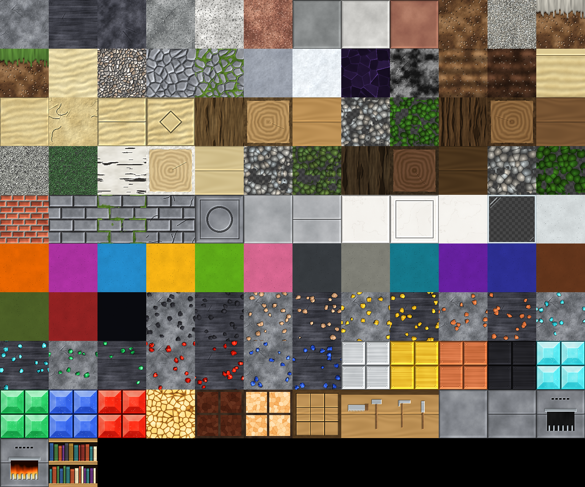
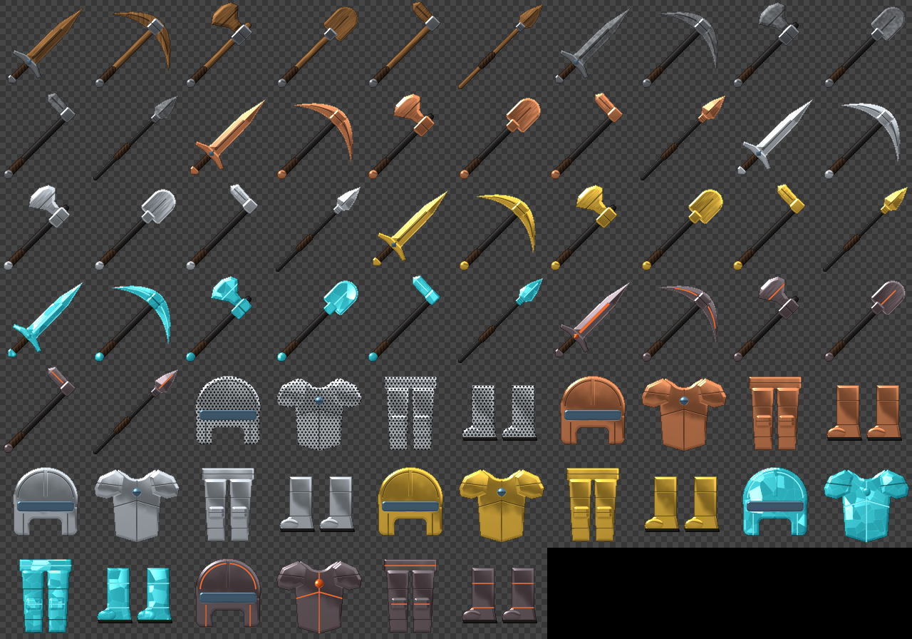
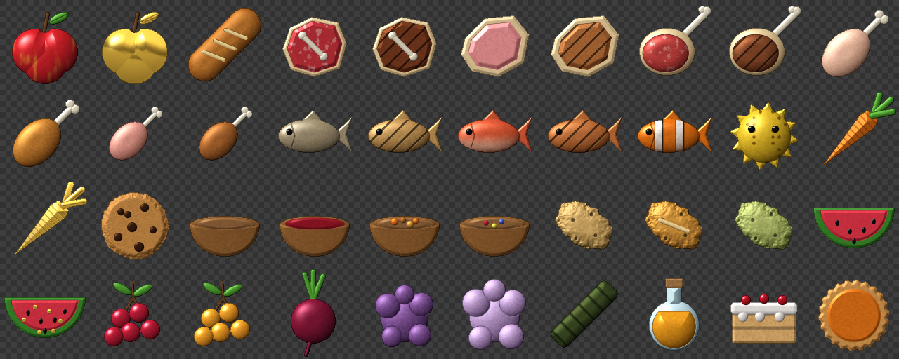
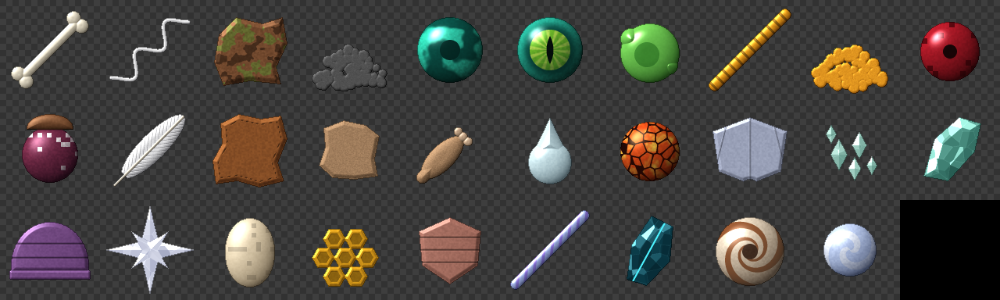
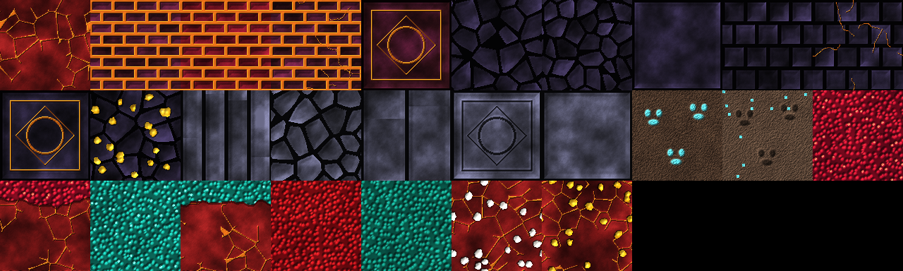

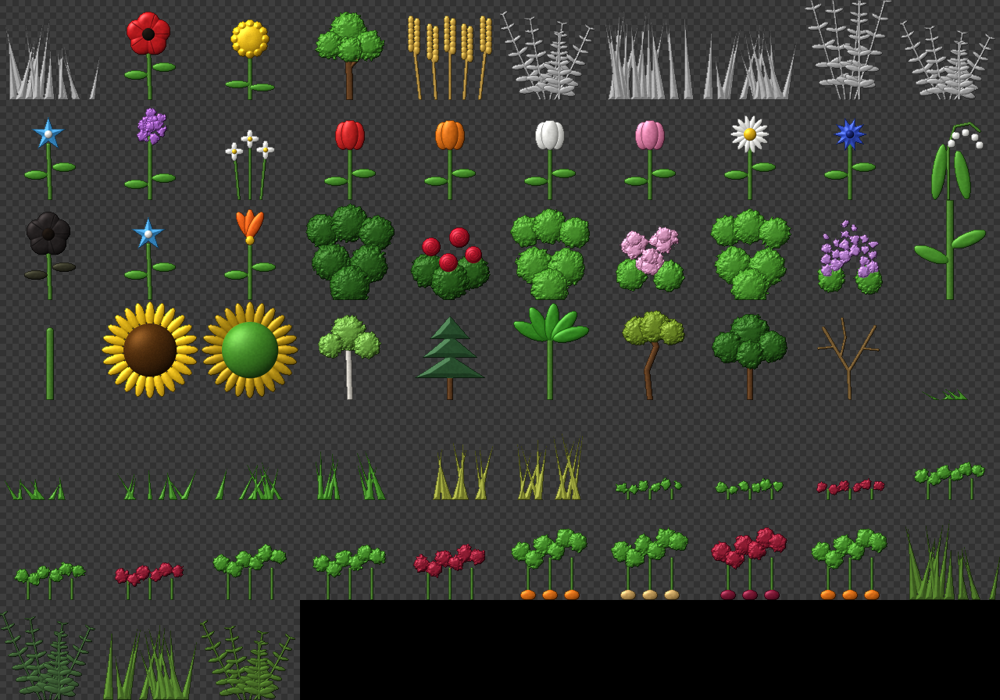
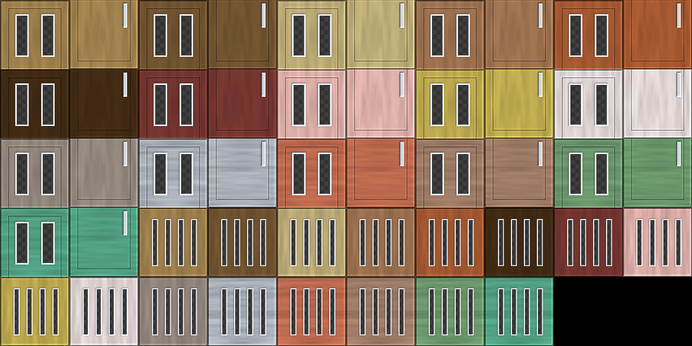
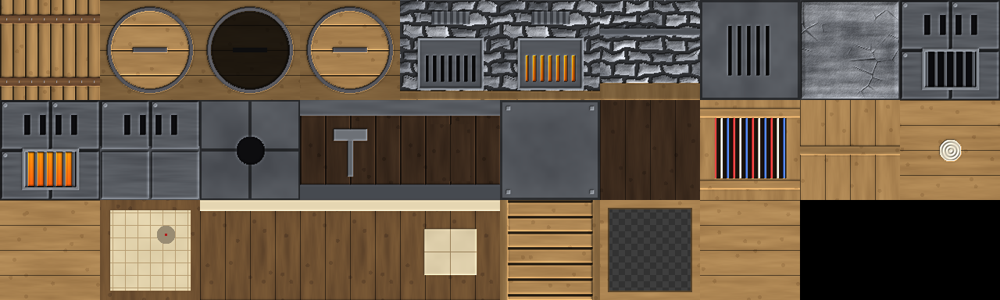
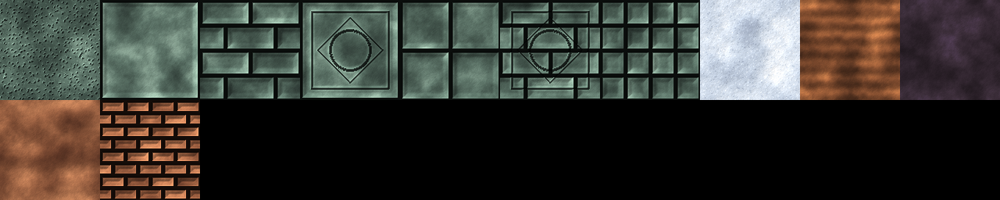
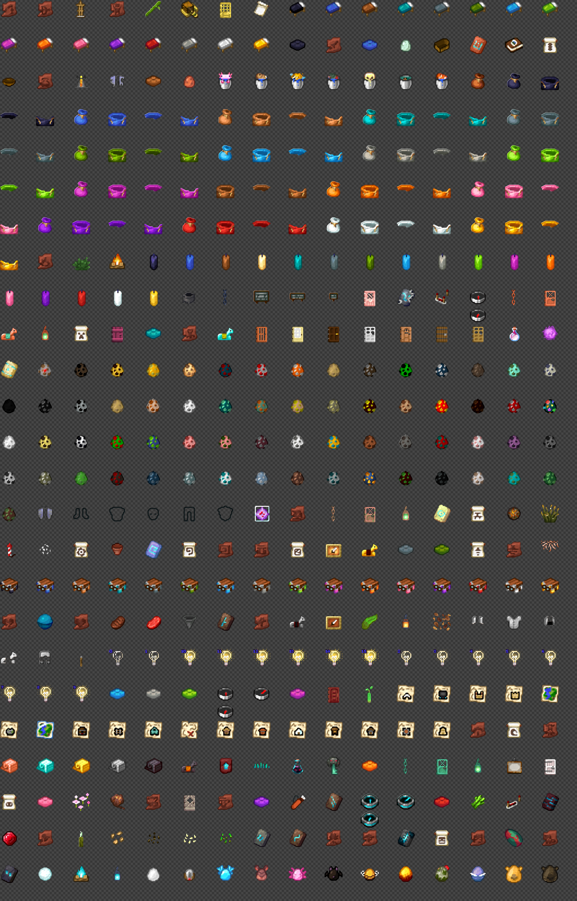
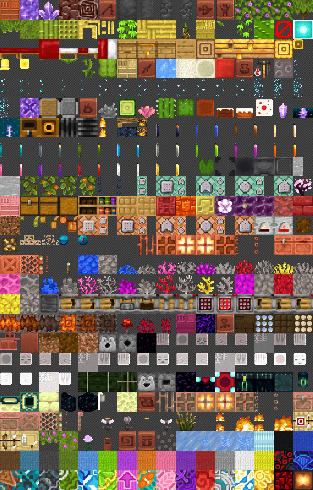

## Building

Needs Node.js 22+ and Mojang's official sample resource pack (only the textures are used):

```bash
git clone --depth 1 --filter=blob:none --sparse https://github.com/Mojang/bedrock-samples.git ../bedrock-samples
```

```bash
git -C ../bedrock-samples sparse-checkout set resource_pack/textures/blocks resource_pack/textures/items resource_pack/textures/entity/chest resource_pack/textures/entity/bed resource_pack/textures/entity/shulker resource_pack/textures/models/armor
```

```bash
node gen.js && node families.js ../bedrock-samples/resource_pack && node items.js && node batch2.js ../bedrock-samples/resource_pack && node batch3.js ../bedrock-samples/resource_pack && node remaster.js ../bedrock-samples/resource_pack && node pack.js
```

On Windows, if git complains about long paths, add `-c core.longpaths=true` to the clone.

- `gen.js` wipes and rebuilds `USTP/` with the signature blocks, manifest and pack icon, and starts `.handmade.json`. Palettes are in the `P` and `WOOD` objects.
- `families.js` adds the colour, wood and copper families, taking each variant's colour from vanilla.
- `items.js` renders the equipment icons (`--sheet=<file.png>` for a contact sheet).
- `batch2.js` and `batch3.js` build the style-picked families in the style recorded in `choices.json` (A Clean Modern, B Natural Realistic, C Bold). `node batch2.js --samples=choices` / `node batch3.js --samples=choices` render the A/B/C comparison sheets used to pick them.
- `remaster.js` fills in every texture not listed in `.handmade.json`. `--only=<substring>` limits it to matching paths, `--sheet=<file.png>` writes a contact sheet.
- `pack.js` zips `USTP/` into `USTP_128x.mcpack`; `node pack.js --lite` builds `USTP_64x_Lite.mcpack`, a half-resolution copy that installs as its own pack.

## Layout

| Path | What |
| --- | --- |
| `gen.js` | Signature blocks; also exports its generators |
| `families.js` | Dye, wood and copper families |
| `items.js` | Modern weapons, tools and armor icons; the shared item renderer |
| `batch2.js`, `batch3.js`, `choices.json` | Style-picked families and the picks themselves |
| `choices/` | A/B/C comparison sheets |
| `remaster.js` | Vanilla → USTP remaster (Scale2x, Kuwahara, PBR) |
| `imageio.js` | Dependency-free PNG/TGA reading and writing |
| `pack.js` | Builds the `.mcpack` files (full and `--lite`) |
| `USTP/` | Built resource pack source |
| `preview*.png` | Contact sheets |
