# USTP — Ultimate Survival Texture Pack

A 128×128 Minecraft **Bedrock** resource pack with a clean, modern look. **About 1,750 blocks and items are fully hand-designed**; the remaining ~530 textures, which wrap complex 3D models or are drawn by the engine, get a cleaned-up 128x remaster. Ships PBR maps for **Vibrant Visuals** and **RTX**: metalness / emissive / roughness / subsurface plus a heightmap for blocks, and MERS for items.

## Install

1. Download `USTP.mcpack` from the [latest release](../../releases/latest) and double-click it. One download covers every device.
2. Settings → Global Resources → My Packs → activate **Ultimate Survival Texture Pack (USTP)**.
3. Click the gear icon on the pack to pick a quality level:
   - **128x Full quality**: PC, Xbox Series X|S, PS5
   - **64x Balanced**: tablets and mid-range devices
   - **32x Performance**: phones, Nintendo Switch, Xbox One, PS4

   Each level declares how much memory it needs, so the game can steer lower-memory devices to the lighter levels.
4. Settings → Video → Graphics Mode → **Vibrant Visuals** (or **Ray Tracing** on an RTX-capable GPU) to see the PBR lighting.

## Troubleshooting

- **Crash when opening a world:** lower Render Distance (Settings → Video) to 32 chunks or less, make sure only one big texture pack is active, and switch the pack to 64x or 32x with its gear icon.
- **RTX** only runs on Windows PCs with a ray-tracing GPU; consoles use regular graphics or Vibrant Visuals.

## What's in it

| Set | Count | Size | How it's made |
| --- | --- | --- | --- |
| Signature blocks | 114 | 128x | Hand-designed procedurally in `gen.js`: stone family, dirt/grass, oak/spruce/birch/dark oak, ores, storage blocks, quartz, concrete, glass, utility blocks |
| Block families | 135 | 128x | `families.js`: all 16 wool, terracotta, concrete powder and stained glass colours, acacia/jungle/mangrove/cherry/pale oak/poplar wood, every stripped log, leaves, copper oxidation stages |
| Modern equipment | 66 | 128x | `items.js`: swords, pickaxes, axes, shovels, hoes and spears in all 7 tiers; chainmail, copper, iron, gold, diamond and netherite armor |
| Batch 2 (style-picked) | 34 blocks, 69 items | 128x | `batch2.js`: deepslate (Clean Modern), Nether blocks (Bold, glowing ember seams), all food and mob drops (Clean Modern) |
| Batch 3 (style-picked) | 151 blocks | 128x | `batch3.js`: every plant, flower, sapling and crop stage (Clean Modern); every door and trapdoor incl. iron and copper (Clean Modern); workstations (Natural Realistic); tuff, calcite, dripstone and mud families (Bold) |
| Batch 4 (style-picked) | 47 blocks | 128x | `batch4.js`: pumpkins, jack-o'-lanterns, melons, hay, cactus, sugar cane (Clean Modern); torches (Natural Realistic); rails, pistons, observers, dispensers, droppers (Bold); ice, packed/blue ice, powder snow, frosted ice (Bold) |
| Batch 5 (style-picked) | 68 items, 14 blocks | 128x | `batch5.js`, all Clean Modern: ingots, gems, raw ores, nuggets, dusts and bricks; bows and crossbows with every draw stage, arrows, trident, mace; shears, buckets, fishing rods, books, lead, saddle, compass, clock and more; prismarine, sponges, every coral block |
| Batch 6 (style-picked) | 25 blocks, 163 items | 128x / 64x | `batch6.js`: vines, lily pads, mushrooms and mushroom blocks, berry bushes, moss, glow lichen (Clean Modern); end stone, end bricks, purpur, portal frame, chorus (Clean Modern); every potion, dye, bottle, nether wart and sugar (Clean Modern, 64x, liquid colours from vanilla); every boat, chest boat, raft, minecart and sign (Natural Realistic) |
| Batch 7 (style-picked) | 38 blocks, 23 items | 128x | `batch7.js`, all Clean Modern: ladder, iron bars, scaffolding, jukebox, note block, chiseled bookshelf, cauldron, enchanting table; red sand and red sandstone; animated sculk and sculk vein, sculk catalyst, amethyst blocks and crystals; every music disc |
| Batch 8 (Clean Modern) | 510 items | 64x / 128x | `batch8.js`: every remaining item — spawn eggs, bundles, tipped arrows, explorer maps, light blocks, beds, harnesses, candles, cushions, fish buckets, door items, chains, lanterns, seeds, pottery sherds, smithing templates, banner patterns, horse and nautilus armor, empty armor slots, and ~70 one-off items. Colours sampled from vanilla |
| Batch 9 (Clean Modern) | 297 blocks | 128x | `batch9.js`: glazed terracotta, glass pane edges, shulker tops, crimson and warped wood, bamboo, copper bulbs/grates/bars/chests, quartz variants, raw ore and netherite blocks, obsidians, bone, honey, slime, TNT, resin, cinnabar, sulfur, bee nests, dirt and grass variants, suspicious sand and gravel, cake, chests, shelves, and every remaining plant sprite |
| Remastered (kept) | ~530 | 64x–128x | `remaster.js`: textures wrapped around complex 3D models (candles, chains, lanterns, decorated pots, dripleaves, cocoa, anvil, bell, lectern, grindstone, stonecutter, brewing stand, sniffer egg…), engine-drawn ones (water, lava, fire, portals, bubble columns), creative-only blocks, block entities (chests, beds, shulkers) and worn armor |

**Equipment** is rendered from signed-distance shapes with bevelled height fields, chrome-style environment reflections, faceted diamond and glowing netherite seams (emissive in Vibrant Visuals). Blades have a centre ridge, fuller and sharpened edges; grips are leather-wrapped.

**Sizes:** animated textures (water, lava, fire, portals…) use 64x frames, because every frame sits in the block atlas. Item icons other than equipment are 64x: all ~900 share one atlas, which overflowed at 128x and showed as pink missing textures.

**The remaster** upscales with Scale2x (crisp pixel-art shapes, rounded diagonals), then a Kuwahara filter melts vanilla's pixel noise into flat, clean surfaces with sharp edges, followed by soft relief lighting and a vibrant colour grade that leaves biome-tinted (greyscale) textures neutral. Mojang's own Vibrant Visuals MERS maps are upscaled alongside, so emissive, metallic and subsurface areas stay where vanilla puts them.


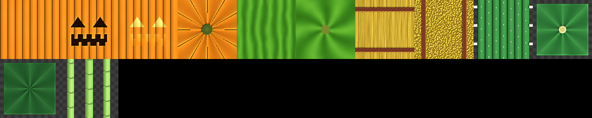
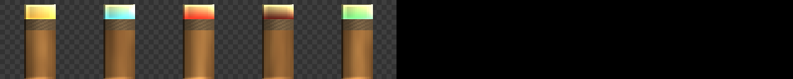
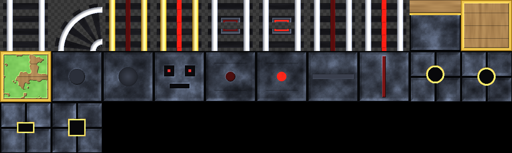

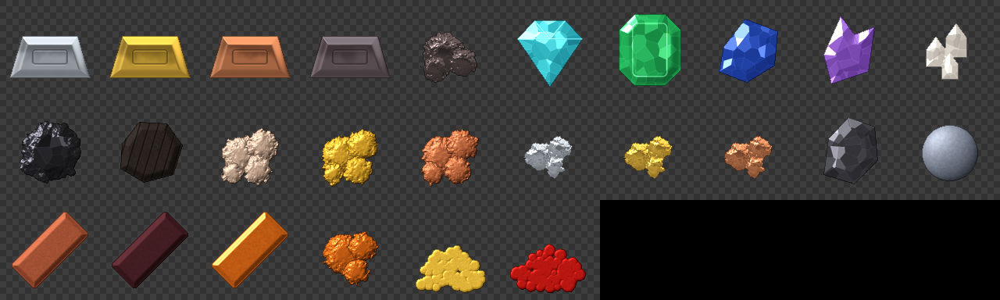
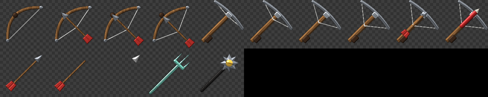
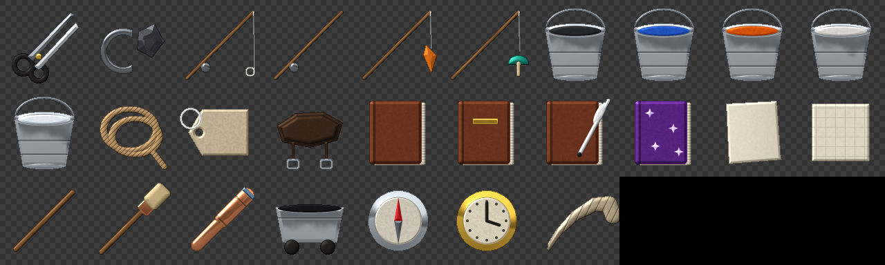
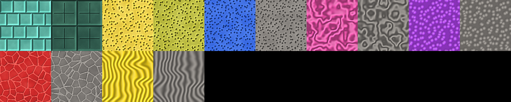
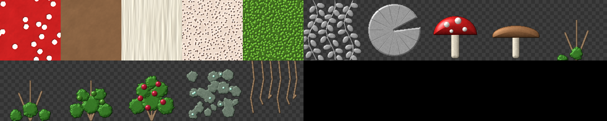
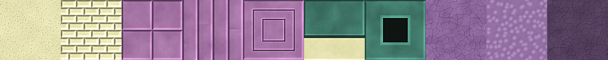
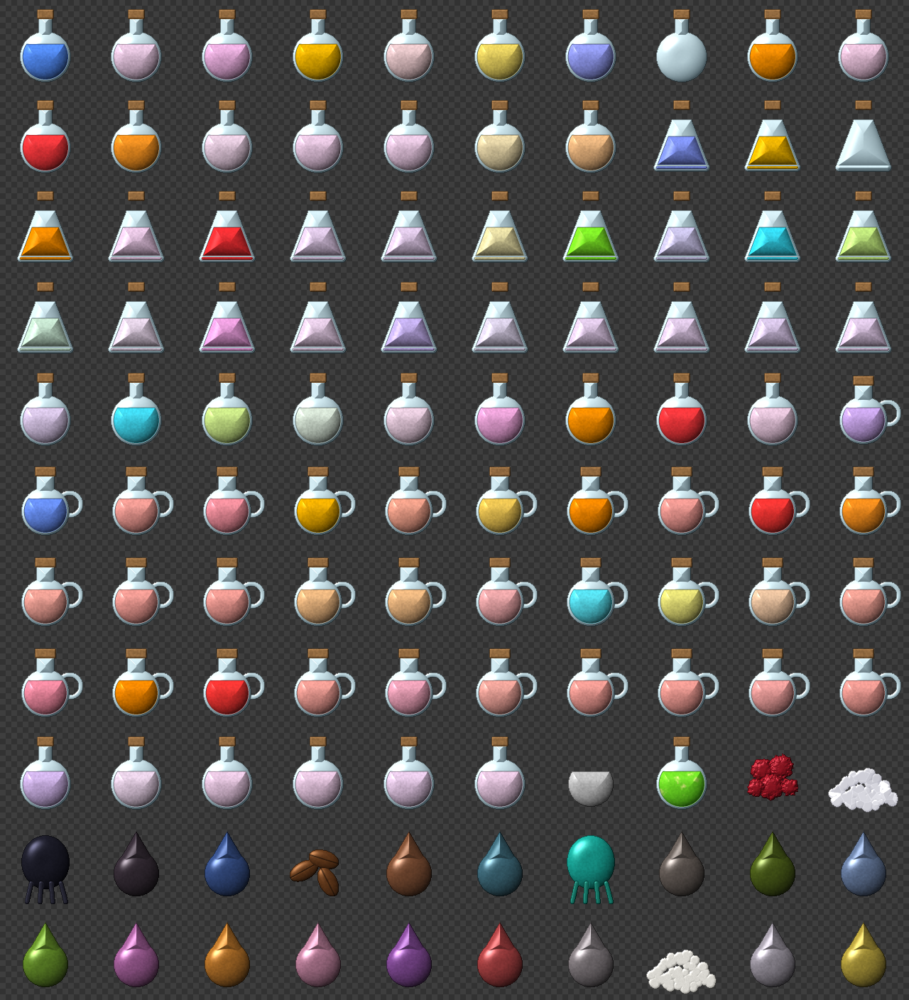
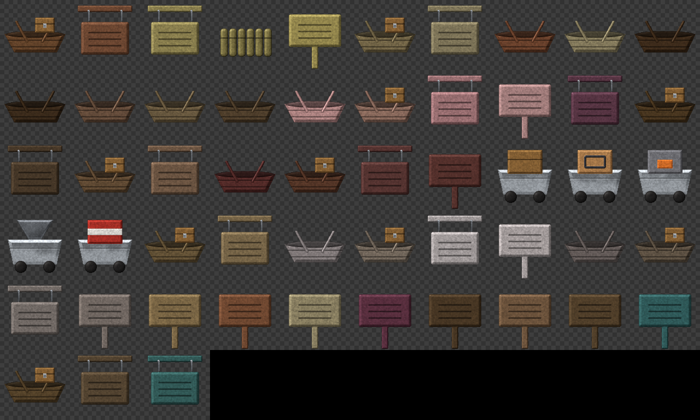
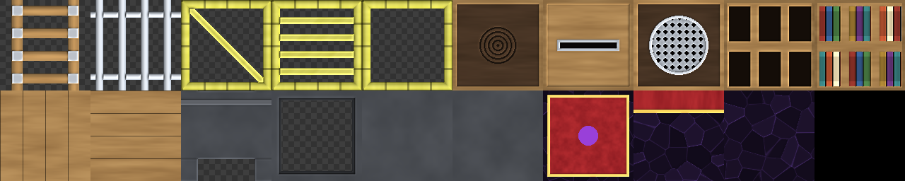

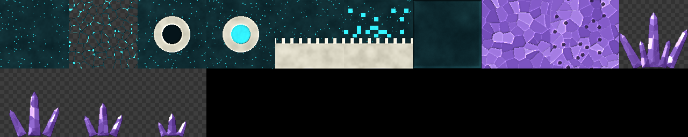
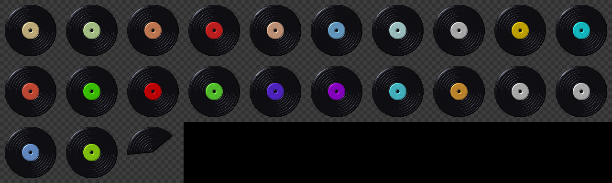
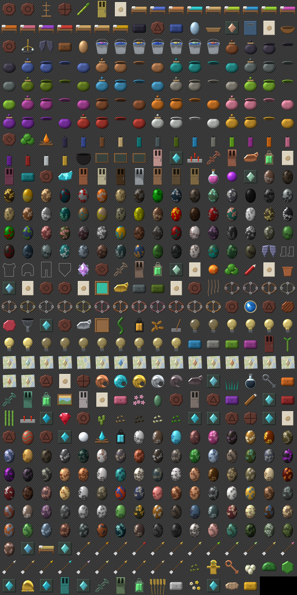
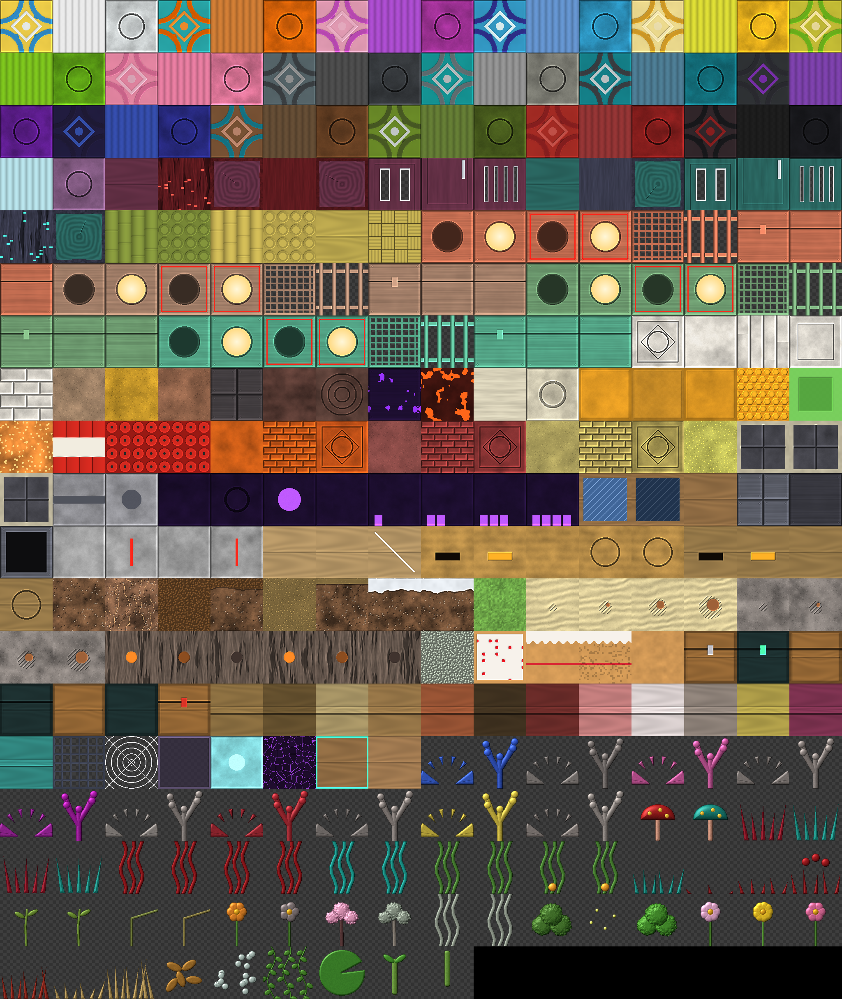


## Building

Needs Node.js 22+ and Mojang's official sample resource pack (only the textures are used):

```bash
git clone --depth 1 --filter=blob:none --sparse https://github.com/Mojang/bedrock-samples.git ../bedrock-samples
```

```bash
git -C ../bedrock-samples sparse-checkout set resource_pack/textures/blocks resource_pack/textures/items resource_pack/textures/entity/chest resource_pack/textures/entity/bed resource_pack/textures/entity/shulker resource_pack/textures/models/armor
```

```bash
node gen.js && node families.js ../bedrock-samples/resource_pack && node items.js && node batch2.js ../bedrock-samples/resource_pack && node batch3.js ../bedrock-samples/resource_pack && node batch4.js ../bedrock-samples/resource_pack && node batch5.js ../bedrock-samples/resource_pack && node batch6.js ../bedrock-samples/resource_pack && node batch7.js ../bedrock-samples/resource_pack && node batch8.js ../bedrock-samples/resource_pack && node batch9.js ../bedrock-samples/resource_pack && node sandcut.js && node stonecut.js && node polished.js && node remaster.js ../bedrock-samples/resource_pack && node pack.js
```

On Windows, if git complains about long paths, add `-c core.longpaths=true` to the clone.

- `gen.js` wipes and rebuilds `USTP/` with the signature blocks, manifest and pack icon, and starts `.handmade.json`. Palettes are in the `P` and `WOOD` objects.
- `families.js` adds the colour, wood and copper families, taking each variant's colour from vanilla.
- `items.js` renders the equipment icons (`--sheet=<file.png>` for a contact sheet).
- `batch8.js` and `batch9.js` redesign everything that was left, in Clean Modern, sampling each variant's colours from vanilla.
- `batch2.js` – `batch7.js` build the style-picked families in the style recorded in `choices.json` (A Clean Modern, B Natural Realistic, C Bold). `node batchN.js --samples=choices` renders the A/B/C comparison sheets used to pick them.
- `remaster.js` fills in every texture not listed in `.handmade.json`. `--only=<substring>` limits it to matching paths, `--sheet=<file.png>` writes a contact sheet.
- `pack.js` builds `USTP.mcpack`: the full 128x textures plus 64x and 32x subpacks (every texture downsampled), each with a memory tier.

## Layout

| Path | What |
| --- | --- |
| `gen.js` | Signature blocks; also exports its generators |
| `families.js` | Dye, wood and copper families |
| `sandcut.js`, `stonecut.js`, `polished.js` | Cut sandstone, cut-stone and polished deepslate styles; applied when `choices.json` names one ("cut_sandstone", "cut_stone", "polished_deepslate") |
| `planks.js` | Plank styles; the one named in `choices.json` ("planks") is used for every plank block |
| `items.js` | Modern weapons, tools and armor icons; the shared item renderer |
| `batch2.js` – `batch9.js`, `choices.json` | Style-picked families and the picks themselves |
| `choices/` | A/B/C comparison sheets |
| `remaster.js` | Vanilla → USTP remaster (Scale2x, Kuwahara, PBR) |
| `imageio.js` | Dependency-free PNG/TGA reading and writing |
| `pack.js` | Builds `USTP.mcpack` with 128x / 64x / 32x subpacks |
| `USTP/` | Built resource pack source |
| `preview*.png` | Contact sheets |
